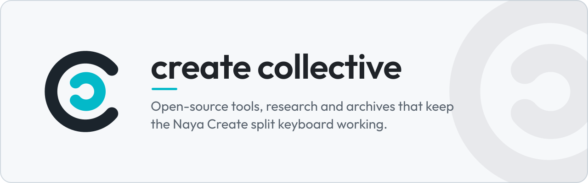

  <picture>
    <source media="(prefers-color-scheme: dark)" srcset="assets/banner-dark.svg">
    
  </picture>

  <a href="https://create-collective.github.io/Create-knowledge-base/"><b>Knowledge base</b></a>
  &nbsp;·&nbsp;
  <a href="https://github.com/create-collective/openflow/releases/latest"><b>Download OpenFlow</b></a>
  &nbsp;·&nbsp;
  <a href="https://github.com/create-collective/create-companion/releases/latest"><b>Download Create Companion</b></a>
  &nbsp;·&nbsp;
  <a href="https://discord.gg/jNtmvdD3Ae">Discord</a>
  &nbsp;·&nbsp;
  <a href="https://github.com/create-collective/.github/blob/main/CONTRIBUTING.md">Contributing</a>
  &nbsp;·&nbsp;
  <a href="https://buymeacoffee.com/traviswye">Buy me a coffee</a>

Naya B.V. ceased operations in August 2026 and no longer supports the **Naya Create**. The
keyboards still work, and we mean to keep them working. Create Collective is an independent
community effort: open software to configure the keyboard and its modules, an evidence-backed
record of how the hardware works, and an archive of everything Naya released for it.

## Projects

| Project | What it does |
|---|---|
| **[Create&nbsp;Companion](https://github.com/create-collective/create-companion)**  | Per-app gestures for the Tune and Touch. The dial is "next tab" in Chrome, "brush size" in Photoshop and "volume" on the desktop, with a catalog of 160+ apps and 22,000+ documented shortcuts. Windows and macOS. |
| **OpenFlow**  | An open-source replacement for NayaFlow: key bindings, lighting, macros, modules and firmware updates. Read-only until you choose to flash, and it refuses any firmware image whose hash doesn't match. Windows, macOS and Linux. |
| **[Create&nbsp;knowledge&nbsp;base](https://create-collective.github.io/Create-knowledge-base/)**  | Hardware, USB and Bluetooth, the wire protocol, firmware and flashing, storage, recovery and the host software. Every fact has a source and an evidence tag. |
| **[create-legacy-firmware](https://github.com/create-collective/create-legacy-firmware)**  | A record of every NayaFlow release (25 stable, with digests and release notes) and the firmware library OpenFlow downloads from: 33 distinct images carved from those releases, each pinned by hash. |

### 3D models and hardware

Printable parts and open hardware for the Create. These repositories open soon.

| Project | What it is |
|---|---|
| **OpenFloat**  | A 6-DoF space mouse that docks in the Create's module bay, with a printable enclosure and its own boards and firmware. |
| **keycapEngine**  | A parametric keycap generator. 21 profiles, from Cherry, OEM and SA to KAM and MT3, built for every key of a layout and exported as STL, 3MF or STEP. The Naya Create is its first layout. |

## Where to start

- **Remap keys, change the lighting or update firmware.** Download
  [OpenFlow](https://github.com/create-collective/openflow/releases/latest).
- **Make your Tune or Touch do different things in each app.** Install
  [Create Companion](https://github.com/create-collective/create-companion/releases/latest).
- **Rescue a board that's dark, wedged or stuck in its bootloader.** Read
  [Recovery](https://create-collective.github.io/Create-knowledge-base/recovery/) and
  [Troubleshooting](https://create-collective.github.io/Create-knowledge-base/troubleshooting/).
- **Understand how the Create works, or build your own tool for it.** Start at the
  [knowledge base](https://create-collective.github.io/Create-knowledge-base/), its
  [Tools](https://create-collective.github.io/Create-knowledge-base/tools/) page and the
  [open questions](https://create-collective.github.io/Create-knowledge-base/open-questions/).
- **Find an old NayaFlow release or firmware version.** See
  [create-legacy-firmware](https://github.com/create-collective/create-legacy-firmware).

## How we work

- **Evidence first.** Every fact in the knowledge base says how we know it (measured on a board,
  read from Naya's released software, documented, inferred, or reported by someone else) and where
  it came from. Open questions are listed with what would settle them.
- **Safe by default.** Our tools read before they write, ask before they flash, and check every
  firmware image against the hash recorded when it was archived.
- **Naya's material stays Naya's.** Vendor firmware and installers are preserved as released and
  never relicensed. We don't publish key extraction, protection bypasses, or anyone's serial
  numbers and Bluetooth addresses.
- **Open licenses.** Code is MIT or Apache-2.0; documentation is CC BY 4.0.

## Get involved

You don't need to write code to help. If your board runs a different firmware version, you use
another operating system, or you have a spare module, you can settle an open question with a
read-only check.

- **Want to talk it through first?** Join the other owners on [Discord](https://discord.gg/jNtmvdD3Ae).
- **Found a bug or want a feature?** Open an issue in that project's repository.
- **Have a correction for the knowledge base?** Open an issue or pull request with both halves'
  firmware versions, your module firmware, your OS and the date.
- **Want your favorite app in Create Companion?** Add it to the catalog: one JSON file per app,
  with its sources cited.
- **Found a security problem?** Report it privately, as our
  [security policy](https://github.com/create-collective/.github/blob/main/SECURITY.md) describes.

Read [CONTRIBUTING.md](https://github.com/create-collective/.github/blob/main/CONTRIBUTING.md)
before your first pull request. Our
[code of conduct](https://github.com/create-collective/.github/blob/main/CODE_OF_CONDUCT.md)
applies everywhere we work.

## Thanks

This work builds on others':
[nayactl](https://github.com/Qonfused/nayactl) by Cory Bennett (Qonfused), the first public
decoding of the Create's USB protocol;
[naya-create-kb](https://nemezzizz.github.io/naya-create-kb/) by Aleksei Ilin (NemeZZiZZ);
[createflow-dongle](https://github.com/mediaandmerch/createflow-dongle) by mediaandmerch; and
[ShortcutMapper](https://github.com/waldobronchart/ShortcutMapper) by Waldo Bronchart and
contributors.

Create Collective is independent of Naya B.V. and not affiliated with or endorsed by it.
Naya Create, Tune, Touch, Track and NayaFlow are Naya's product names, used here only to say what
our work is for.
